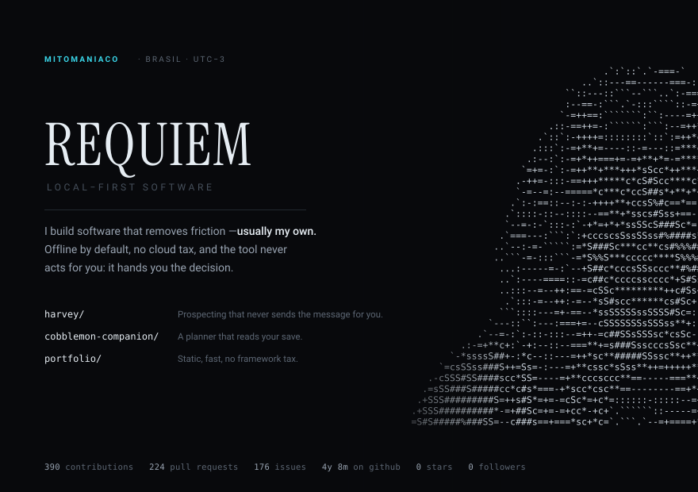

  <picture>
    <source media="(prefers-color-scheme: dark)" srcset="assets/card-dark.svg">
    <source media="(prefers-color-scheme: light)" srcset="assets/card-light.svg">
    
  </picture>

I build software that removes friction — usually my own.
Offline by default, no cloud tax, and the tool never acts for you: it hands you the decision.

**Harvey** — prospecting that never sends the message for you. `node:sqlite`, local.
**Cobblemon Companion** — a planner that reads your save. `electron`, `react`.

Numbers &amp; how this card is built

`scripts/build_profile.py` talks to the GitHub API and writes `assets/card-dark.svg`
and `assets/card-light.svg`. The wordmark is outlined path data — no web font, so
nothing falls back or gets blocked. The portrait is ASCII locked to a fixed grid
with `textLength`, so it keeps its shape on any monospace font. A GitHub Action
refreshes the numbers once a day; the screenshot in `preview/` is only for local
comparison and is not part of the profile.

